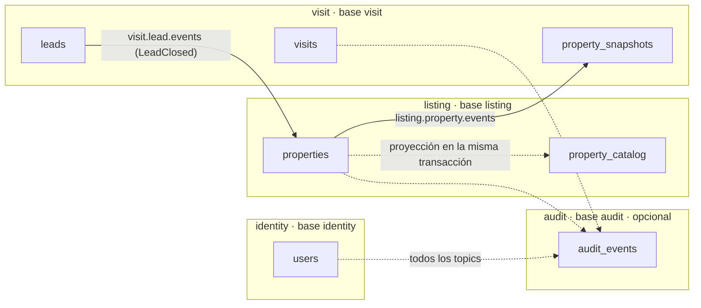

# Esquemas de base de datos por servicio

Diseño de referencia de la base de cada servicio, derivado del event storming y del [ADR 0005](../adr/0005-realinear-servicios-y-cadenas-de-eventos.md).

- **Motor:** PostgreSQL 17, una base y un usuario por servicio (`infra/docker-compose.yml`). Ningún servicio lee la base de otro (regla de oro 1).
- **Es una referencia, no la migración.** Cada responsable la traduce a las migraciones de su stack:
  - identity: migraciones de Django (ya existen).
  - listing: Flyway (`V20261016_1430__create_property.sql`, ver `services/listing-service/CLAUDE.md`).
  - visit: migraciones de TypeORM (`synchronize: false`, ver `services/visit-service/CLAUDE.md`).
- **Si una migración se aparta de este documento,** se actualiza el documento en el mismo PR.

| Servicio | Base | Tablas | Detalle |
|---|---|---|---|
| identity-service | `identity` | `users`, `used_refresh_tokens`, `revoked_refresh_families`, `outbox` | [identity-service.md](identity-service.md) (ya implementado) |
| listing-service | `listing` | `properties`, `property_features`, `property_images`, `favorites`, `property_catalog`, `outbox`, `processed_events` | [listing-service.md](listing-service.md) |
| visit-service | `visit` | `property_snapshots`, `inquiries`, `visits`, `leads`, `lead_follow_ups`, `outbox`, `processed_events` | [visit-service.md](visit-service.md) |
| audit-service (opcional) | `audit` | `audit_events` | [audit-service.md](audit-service.md) |

## Convenciones

| Tema | Regla | Por qué |
|---|---|---|
| Nombres | Tablas en plural y columnas en `snake_case`, en inglés. El JSON de la API sigue en camelCase: el mapper traduce. | Convención de PostgreSQL; el idioma del código es inglés |
| IDs | `uuid` como clave primaria, **generado por el dominio**. Sin `DEFAULT gen_random_uuid()` ni secuencias. | El aggregate tiene identidad antes de guardarse, y el ID va en los eventos |
| Referencias a otro servicio | Solo el ID (`agent_id`, `client_id` = `sub` del JWT; `property_id` en visit). **Sin foreign key.** | La otra base no existe para este servicio |
| Referencias dentro del servicio | Foreign key. Las entidades hijas de un aggregate usan `ON DELETE CASCADE`. | Integridad dentro del bounded context |
| Fechas | `timestamptz`, siempre en UTC | Convención global de `CLAUDE.md` |
| Dinero | `numeric(14,2)` + `char(3)` con `CHECK (currency = 'BOB')` | Nunca float; moneda única |
| Enums | `varchar` + `CHECK (... IN (...))`, en `UPPER_SNAKE_CASE`. No se usan los tipos `ENUM` de PostgreSQL. | Agregar un valor es un `ALTER ... CHECK`, sin migraciones especiales |
| Concurrencia | Columna `version bigint` en los aggregates que pueden cambiar a la vez una persona y una política (`properties`, `visits`, `leads`). JPA: `@Version`. TypeORM: `@VersionColumn`. | Bloqueo optimista: si el agente y el consumidor Kafka tocan el mismo aggregate, uno falla y reintenta en vez de pisar al otro |
| Reglas de negocio | Se validan **en el dominio**. La base repite solo las que se pueden romper por concurrencia (índices únicos parciales, exclusión) y los `CHECK` baratos. | El dominio da el error claro (409); la base es la red de seguridad |

## Tablas comunes de mensajería

Todos los servicios que **publican** eventos tienen `outbox`. Todos los que **consumen** tienen `processed_events`. Mismo formato que la implementación de identity.

```sql
-- Eventos de integración pendientes de publicar (patrón Outbox).
-- Se insertan en la misma transacción que el aggregate; el relay los publica y llena published_at.
CREATE TABLE outbox (
    id            uuid         PRIMARY KEY,          -- = eventId del envelope
    topic         varchar(255) NOT NULL,
    aggregate_id  varchar(36)  NOT NULL,             -- clave del mensaje en Kafka
    envelope      jsonb        NOT NULL,             -- envelope completo, listo para publicar
    created_at    timestamptz  NOT NULL DEFAULT now(),
    published_at  timestamptz
);
CREATE INDEX outbox_pending_idx ON outbox (created_at) WHERE published_at IS NULL;

-- Eventos ya procesados por un consumidor (idempotencia: entrega al menos una vez).
-- Se inserta en la misma transacción que el efecto del evento.
CREATE TABLE processed_events (
    event_id      uuid         PRIMARY KEY,
    event_type    varchar(100) NOT NULL,
    processed_at  timestamptz  NOT NULL DEFAULT now()
);
```

| Servicio | `outbox` | `processed_events` |
|---|---|---|
| identity | Sí | No (no consume) |
| listing | Sí | Sí (`visit.lead.events`) |
| visit | Sí | Sí (`listing.property.events`) |
| audit | No (no publica) | No: su clave primaria `event_id` ya es la idempotencia |

## Mapa de lo que viaja por Kafka

Ninguna tabla se comparte. Lo que un servicio necesita de otro lo copia desde los eventos:


