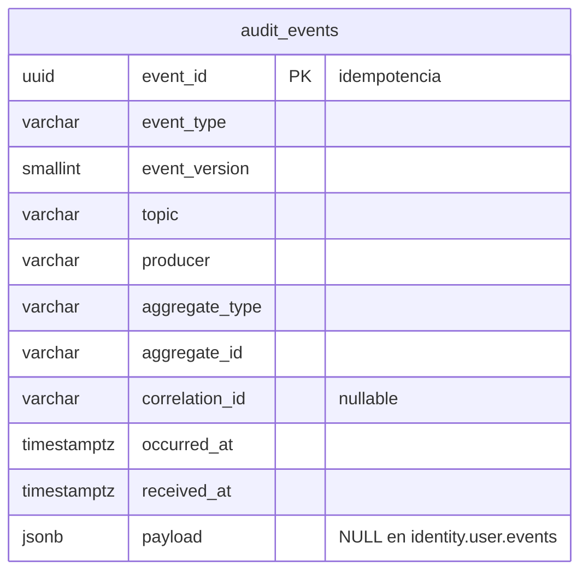

# Base de datos — audit-service (opcional)

- **Base:** `audit` (PostgreSQL 17, si el equipo confirma ese motor al arrancar el servicio; ADR 0005, sección 5).
- **Sin aggregates de dominio rico:** es un registro de solo inserción de los eventos que pasan por Kafka.
- **Sin `outbox`** (no publica) **ni `processed_events`**: la clave primaria `event_id` ya hace al consumidor idempotente.

## Diagrama



## SQL de referencia

```sql
CREATE TABLE audit_events (
    event_id        uuid          PRIMARY KEY,           -- un duplicado choca: INSERT ... ON CONFLICT DO NOTHING
    event_type      varchar(100)  NOT NULL,
    event_version   smallint      NOT NULL,
    topic           varchar(255)  NOT NULL,
    producer        varchar(50)   NOT NULL,
    aggregate_type  varchar(50)   NOT NULL,
    aggregate_id    varchar(36)   NOT NULL,
    correlation_id  varchar(36),
    occurred_at     timestamptz   NOT NULL,
    received_at     timestamptz   NOT NULL DEFAULT now(),
    payload         jsonb,

    -- identity.user.events lleva email y nombre: de ese topic solo se guarda el envelope.
    CONSTRAINT audit_events_no_identity_payload CHECK (topic <> 'identity.user.events' OR payload IS NULL)
);
CREATE INDEX audit_events_aggregate_idx ON audit_events (aggregate_id, occurred_at);  -- historial de una propiedad, visita, ...
CREATE INDEX audit_events_type_idx      ON audit_events (event_type,   occurred_at);
CREATE INDEX audit_events_time_idx      ON audit_events (occurred_at);

-- Solo inserción: cualquier UPDATE o DELETE falla, aunque lo intente la propia aplicación.
CREATE FUNCTION audit_events_append_only() RETURNS trigger
LANGUAGE plpgsql AS $$
BEGIN
    RAISE EXCEPTION 'audit_events es de solo inserción';
END;
$$;

CREATE TRIGGER audit_events_no_update_delete
    BEFORE UPDATE OR DELETE ON audit_events
    FOR EACH ROW EXECUTE FUNCTION audit_events_append_only();
```

## Consumidor

- Consume **todos** los topics del catálogo desde el principio, con el consumer group `audit-service`.
- Por cada mensaje: `INSERT ... ON CONFLICT (event_id) DO NOTHING` con los campos del envelope. El `payload` se guarda, salvo en `identity.user.events`.
- Un mensaje que no cumple el envelope va a la DLQ de su topic, como en cualquier consumidor.

## Notas

- **`TRUNCATE` no dispara triggers de fila.** Por eso el usuario de base de la aplicación no debe tener permiso `TRUNCATE` ni ser dueño de la tabla. Se configura en el script de inicialización de la base, no en la migración.
- **`GET /api/v1/audit/events`** (solo `ADMIN`) filtra por `aggregate_id`, `event_type` y rango de `occurred_at`, con los tres índices de arriba.
