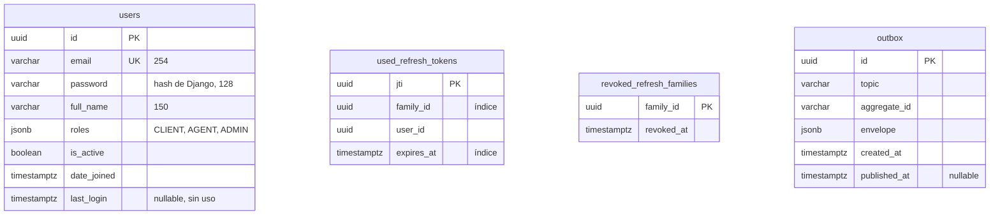

# Base de datos — identity-service

- **Base:** `identity` (PostgreSQL 17, contenedor `identity-db`).
- **Estado:** **ya implementada** con las migraciones de Django en `services/identity-service/identity/infrastructure/persistence/migrations/` (`0001` a `0003`). Este documento la describe; la fuente de verdad son esas migraciones.
- **Aggregate:** `User`. Los refresh tokens no son un aggregate: son un registro técnico de seguridad.

## Diagrama



No hay foreign keys: `used_refresh_tokens.user_id` y las familias se limpian solas por vencimiento (`run_maintenance`, PR #32).

## SQL equivalente

Generado por Django; se muestra para comparar con los demás servicios.

```sql
CREATE TABLE users (
    id           uuid         PRIMARY KEY,
    email        varchar(254) NOT NULL UNIQUE,   -- validado por el value object Email del dominio
    password     varchar(128) NOT NULL,          -- hash PBKDF2 de Django, nunca texto plano
    full_name    varchar(150) NOT NULL,
    roles        jsonb        NOT NULL,          -- lista: ["CLIENT"], ["AGENT"], ["ADMIN"], ...
    is_active    boolean      NOT NULL,
    date_joined  timestamptz  NOT NULL,
    last_login   timestamptz
);

-- Refresh tokens ya canjeados: el PK impide que dos canjes simultáneos pasen los dos.
CREATE TABLE used_refresh_tokens (
    jti         uuid        PRIMARY KEY,
    family_id   uuid        NOT NULL,
    user_id     uuid        NOT NULL,
    expires_at  timestamptz NOT NULL
);
CREATE INDEX ON used_refresh_tokens (family_id);
CREATE INDEX ON used_refresh_tokens (expires_at);

-- Familias de refresh token revocadas (logout o reuso detectado).
CREATE TABLE revoked_refresh_families (
    family_id   uuid        PRIMARY KEY,
    revoked_at  timestamptz NOT NULL
);

-- Outbox: ver docs/base-de-datos/README.md. Django crea índices simples en created_at y published_at.
CREATE TABLE outbox (
    id            uuid         PRIMARY KEY,
    topic         varchar(255) NOT NULL,
    aggregate_id  varchar(36)  NOT NULL,
    envelope      jsonb        NOT NULL,
    created_at    timestamptz  NOT NULL,
    published_at  timestamptz
);
CREATE INDEX ON outbox (created_at);
CREATE INDEX ON outbox (published_at);
```

## Del event storming a la base

| Comando | Qué escribe | Evento en `outbox` |
|---|---|---|
| `registerUserCommand` | `INSERT users` con `roles = ["CLIENT"]` | `UserRegistered` |
| `loginCommand` | Nada, salvo `UPDATE users.password` si toca re-hashear. `last_login` queda nulo (heredado de `AbstractBaseUser`, no se usa) | `UserLoggedIn`, **solo si se construye audit-service** |
| `assignRoleCommand` (pendiente) | `UPDATE users.roles` | `UserRolesAssigned`, **solo si se construye audit-service** |

**No hace falta ninguna migración nueva** para el ADR 0005: asignar roles actualiza la columna `roles`, y los eventos opcionales usan la misma `outbox`.
