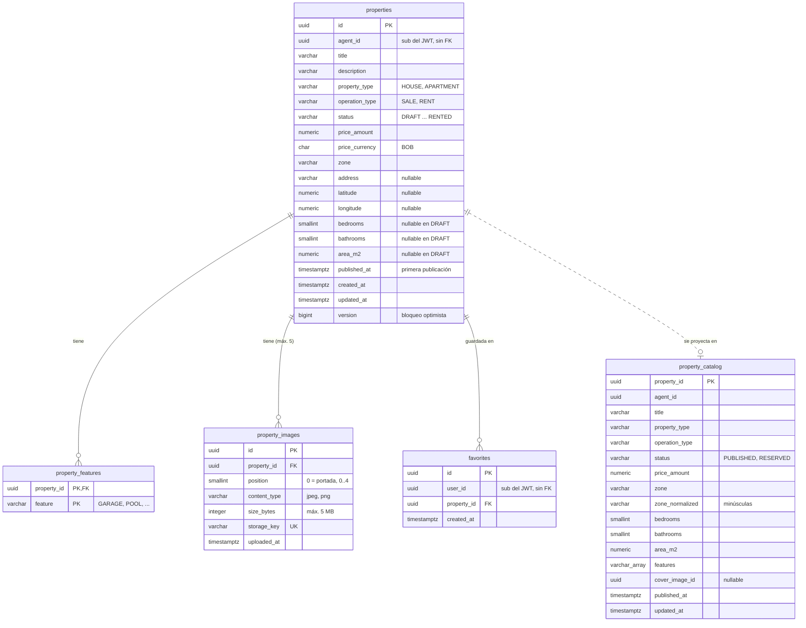

# Base de datos — listing-service

- **Base:** `listing` (PostgreSQL 17). Migraciones con **Flyway** (`services/listing-service/CLAUDE.md`).
- **Aggregates:**
  - `Property`: tablas `properties`, `property_features` y `property_images`. Las imágenes y las características son parte del aggregate: se guardan y cargan con él.
  - `Favorite` (ADR 0003): tabla `favorites`.
- **Lado query (CQRS, ADR 0005):** tabla `property_catalog`, la proyección del catálogo público.
- **Mensajería:** `outbox` (publica `listing.property.events`) y `processed_events` (consume `visit.lead.events`). Formato en el [README](README.md#tablas-comunes-de-mensajería).

## Diagrama



## SQL de referencia

```sql
-- ─── Aggregate Property ──────────────────────────────────────────────────────

CREATE TABLE properties (
    id              uuid          PRIMARY KEY,
    agent_id        uuid          NOT NULL,                 -- dueño de la publicación (sub del JWT)
    title           varchar(150)  NOT NULL,
    description     varchar(5000) NOT NULL DEFAULT '',
    property_type   varchar(20)   NOT NULL CHECK (property_type  IN ('HOUSE', 'APARTMENT')),
    operation_type  varchar(10)   NOT NULL CHECK (operation_type IN ('SALE', 'RENT')),
    status          varchar(20)   NOT NULL DEFAULT 'DRAFT'
                    CHECK (status IN ('DRAFT', 'PUBLISHED', 'PAUSED', 'RESERVED', 'SOLD', 'RENTED')),
    price_amount    numeric(14,2) NOT NULL CHECK (price_amount > 0),   -- en RENT, precio mensual
    price_currency  char(3)       NOT NULL DEFAULT 'BOB' CHECK (price_currency = 'BOB'),
    zone            varchar(100)  NOT NULL,
    address         varchar(255),
    latitude        numeric(9,6)  CHECK (latitude  BETWEEN -90  AND 90),
    longitude       numeric(9,6)  CHECK (longitude BETWEEN -180 AND 180),
    bedrooms        smallint      CHECK (bedrooms  >= 0),
    bathrooms       smallint      CHECK (bathrooms >= 0),
    area_m2         numeric(10,2) CHECK (area_m2   > 0),
    published_at    timestamptz,                            -- primera publicación; no cambia al reanudar
    created_at      timestamptz   NOT NULL,
    updated_at      timestamptz   NOT NULL,
    version         bigint        NOT NULL DEFAULT 0,       -- @Version: el agente y la política LeadClosed pueden chocar

    CONSTRAINT properties_coordinates_together  CHECK ((latitude IS NULL) = (longitude IS NULL)),
    CONSTRAINT properties_sold_only_sale        CHECK (status <> 'SOLD'   OR operation_type = 'SALE'),
    CONSTRAINT properties_rented_only_rent      CHECK (status <> 'RENTED' OR operation_type = 'RENT'),
    CONSTRAINT properties_published_has_date    CHECK (status = 'DRAFT'   OR published_at IS NOT NULL),
    CONSTRAINT properties_published_has_details CHECK (status = 'DRAFT'   OR
        (bedrooms IS NOT NULL AND bathrooms IS NOT NULL AND area_m2 IS NOT NULL))
);
CREATE INDEX properties_agent_idx ON properties (agent_id, status);   -- "mis propiedades" del agente

CREATE TABLE property_features (
    property_id  uuid        NOT NULL REFERENCES properties (id) ON DELETE CASCADE,
    feature      varchar(30) NOT NULL CHECK (feature ~ '^[A-Z_]+$'),  -- la lista válida la decide el dominio
    PRIMARY KEY (property_id, feature)
);

CREATE TABLE property_images (
    id            uuid         PRIMARY KEY,                -- también es el nombre del archivo: nunca el original
    property_id   uuid         NOT NULL REFERENCES properties (id) ON DELETE CASCADE,
    position      smallint     NOT NULL CHECK (position BETWEEN 0 AND 4),   -- 0 = portada
    content_type  varchar(20)  NOT NULL CHECK (content_type IN ('image/jpeg', 'image/png')),
    size_bytes    integer      NOT NULL CHECK (size_bytes BETWEEN 1 AND 5242880),
    storage_key   varchar(255) NOT NULL UNIQUE,            -- ruta dentro del adaptador ImageStorage
    uploaded_at   timestamptz  NOT NULL,
    -- Junto con position 0..4, esto limita a 5 imágenes por propiedad.
    -- DEFERRABLE permite reordenar la galería en una sola transacción.
    CONSTRAINT property_images_position_uq UNIQUE (property_id, position) DEFERRABLE INITIALLY DEFERRED
);

-- ─── Aggregate Favorite (ADR 0003) ──────────────────────────────────────────

CREATE TABLE favorites (
    id           uuid        PRIMARY KEY,
    user_id      uuid        NOT NULL,                     -- sub del JWT
    property_id  uuid        NOT NULL REFERENCES properties (id),   -- mismo servicio: FK sí
    created_at   timestamptz NOT NULL,
    CONSTRAINT favorites_user_property_uq UNIQUE (user_id, property_id)  -- también sirve para "mis favoritos"
);

-- ─── Lado query: catálogo público (CQRS, ADR 0005) ──────────────────────────

-- Proyección desnormalizada, solo para leer. Solo contiene propiedades PUBLISHED o RESERVED.
-- Sin FK a properties: es descartable y se puede reconstruir desde properties.
CREATE TABLE property_catalog (
    property_id      uuid          PRIMARY KEY,
    agent_id         uuid          NOT NULL,
    title            varchar(150)  NOT NULL,
    property_type    varchar(20)   NOT NULL,
    operation_type   varchar(10)   NOT NULL,
    status           varchar(20)   NOT NULL CHECK (status IN ('PUBLISHED', 'RESERVED')),
    price_amount     numeric(14,2) NOT NULL,
    zone             varchar(100)  NOT NULL,
    zone_normalized  varchar(100)  NOT NULL,               -- lower(trim(zone)): filtro sin distinguir mayúsculas
    bedrooms         smallint      NOT NULL,
    bathrooms        smallint      NOT NULL,
    area_m2          numeric(10,2) NOT NULL,
    features         varchar(30)[] NOT NULL DEFAULT '{}',  -- filtro "tiene GARAGE y POOL": features @> ARRAY[...]
    cover_image_id   uuid,
    published_at     timestamptz   NOT NULL,
    updated_at       timestamptz   NOT NULL
);
CREATE INDEX property_catalog_filter_idx   ON property_catalog (operation_type, property_type, price_amount);
CREATE INDEX property_catalog_zone_idx     ON property_catalog (zone_normalized);
CREATE INDEX property_catalog_features_idx ON property_catalog USING gin (features);

-- ─── Mensajería ─────────────────────────────────────────────────────────────
-- outbox y processed_events: ver docs/base-de-datos/README.md
```

## Del event storming a la base

Cada fila es **una transacción**: el cambio del aggregate, la fila del `outbox` (si corresponde) y la proyección del catálogo se guardan juntos.

| Comando | Regla del diagrama → dónde se cumple | Escribe | `outbox` | `property_catalog` |
|---|---|---|---|---|
| `CreateProperty` | Tipo, operación, precio > 0 y zona obligatorios; estado `DRAFT` → dominio + `CHECK` y `NOT NULL` | `INSERT properties` | — | — |
| `UpdatePropertyFeatures` | Dormitorios y baños ≥ 0, superficie > 0, características válidas → dominio + `CHECK` | `UPDATE properties`, `property_features` | `PropertyUpdated` si está `PUBLISHED` o `RESERVED` | upsert si está en el catálogo |
| `AddPropertyImages` | JPG/PNG, máximo 5, no si está vendida o alquilada → dominio + `CHECK position 0..4` + `UNIQUE` | `INSERT property_images` | `PropertyUpdated` si está publicada o reservada | actualiza `cover_image_id` si está en el catálogo |
| `PublishProperty` | Solo desde `DRAFT` (o `PAUSED`), al menos 1 foto, datos completos → dominio + `properties_published_has_details` | `UPDATE properties` | `PropertyPublished` | upsert |
| `EditProperty` | Solo el agente dueño; no si está vendida o alquilada → dominio (dueño = `agent_id`) | `UPDATE properties` | `PropertyUpdated` si está `PUBLISHED` o `RESERVED` | upsert si está en el catálogo |
| `PauseProperty` | Solo si está `PUBLISHED` → dominio | `UPDATE properties` | `PropertyPaused` | `DELETE` |
| `ReserveProperty` | Solo si está `PUBLISHED` → dominio | `UPDATE properties` | `PropertyReserved` | upsert (`status = RESERVED`) |
| `ReleaseReservation` | Solo si está `RESERVED`; vuelve a `PUBLISHED` → dominio | `UPDATE properties` | `PropertyPublished` (`previousStatus: RESERVED`) | upsert |
| `MarkPropertySold` | Solo `SALE` y `PUBLISHED`/`RESERVED`; irreversible → dominio + `properties_sold_only_sale` | `UPDATE properties` | `PropertySold` | `DELETE` |
| `MarkPropertyRented` | Solo `RENT` y `PUBLISHED`/`RESERVED` → dominio + `properties_rented_only_rent` | `UPDATE properties` | `PropertyRented` | `DELETE` |
| `AddFavorite` / `RemoveFavorite` | Solo propiedades `PUBLISHED`; sin repetir → dominio + `favorites_user_property_uq` | `INSERT` / `DELETE favorites` | — | — |

### Política: `LeadClosed` → `ReserveProperty` (ADR 0005, sección 3.1)

En **una sola transacción**:

1. `INSERT INTO processed_events` con el `eventId`. Si ya existe, el evento es un duplicado: se descarta sin hacer nada.
2. Si `outcome = 'WON'`, carga la `Property`, verifica `status = 'PUBLISHED'` y que `agent_id` coincida, y la reserva.
3. `UPDATE properties` (con `version`), `INSERT INTO outbox` (`PropertyReserved`) y upsert en `property_catalog`.

Si la regla de estado rechaza la reserva, se guarda igual el paso 1 (para no reprocesar) y se registra el `WARN`. Si `version` choca con un cambio del agente, la transacción entera falla y el consumidor reintenta.

## Notas

- **Formatos de imagen:** solo JPG y PNG, como dice el event storming (y la rule `seguridad`). Si el equipo quiere WebP, se agrega al `CHECK` y a la rule.
- **Por qué una tabla de catálogo aparte** y no consultar `properties`: es el lado query de CQRS. Las consultas públicas no tocan el aggregate, la tabla está desnormalizada para los filtros (características en un arreglo con índice GIN) y solo contiene lo visible.
- **Reconstruir el catálogo:** `TRUNCATE property_catalog` y volver a llenarla desde `properties` y `property_features` con las propiedades `PUBLISHED` o `RESERVED`.
- **"Mis propiedades" del agente** lee `properties` directamente (todos los estados): una consulta puede saltarse el dominio, pero nunca escribe.
