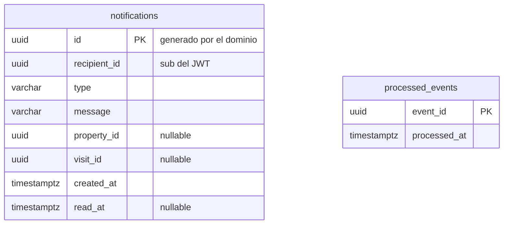

# Base de datos — notification-service

- **Base:** `notification` (PostgreSQL 17, [ADR 0007](../adr/0007-retomar-notification-service.md)).
- **Aggregate:** `Notification`. No tiene relaciones con otras tablas: `recipient_id`, `property_id` y `visit_id` son referencias a otros servicios, sin foreign key.
- **Sin `outbox`** (no publica). **Con `processed_events`:** consume eventos y debe ser idempotente.
- **Sin datos personales:** el destinatario es solo su UUID, y `message` es un texto fijo por tipo de aviso.

## Diagrama



## SQL de referencia

```sql
CREATE TABLE notifications (
    id           uuid         PRIMARY KEY,
    recipient_id uuid         NOT NULL,
    type         varchar(40)  NOT NULL CHECK (type IN ('WELCOME', 'VISIT_REQUESTED', 'PROPERTY_RESERVED', 'INQUIRY_RECEIVED',
                                      'VISIT_SCHEDULED', 'VISIT_REJECTED', 'VISIT_CANCELLED', 'VISIT_CANCELLED_BY_CLIENT', 'VISIT_COMPLETED')),
    message      varchar(255) NOT NULL,
    property_id  uuid,
    visit_id     uuid,
    created_at   timestamptz  NOT NULL,
    read_at      timestamptz
);

-- "Mis avisos, los más nuevos primero", y el filtro de no leídos.
CREATE INDEX notifications_recipient_idx ON notifications (recipient_id, created_at DESC);
CREATE INDEX notifications_unread_idx ON notifications (recipient_id, created_at DESC) WHERE read_at IS NULL;

CREATE TABLE processed_events (
    event_id     uuid        PRIMARY KEY,
    processed_at timestamptz NOT NULL
);
```

## Concurrencia

Sin columna `version`: un aviso solo cambia cuando su destinatario lo marca como leído, y esa operación es idempotente.
