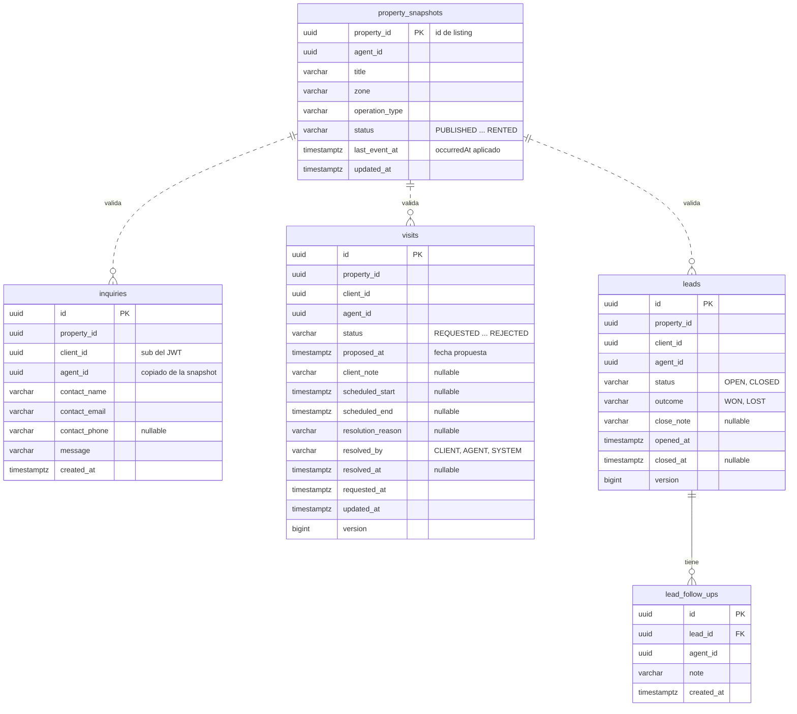

# Base de datos — visit-service

- **Base:** `visit` (PostgreSQL 17). Migraciones de **TypeORM** con `synchronize: false` (`services/visit-service/CLAUDE.md`). El índice de exclusión y los índices parciales se escriben con `queryRunner.query(...)`.
- **Aggregates:**
  - `Inquiry`: tabla `inquiries`.
  - `Visit`: tabla `visits`.
  - `Lead`: tablas `leads` y `lead_follow_ups` (los seguimientos son entidades hijas del aggregate).
- **Modelo de lectura alimentado por eventos:** `property_snapshots`, la copia local de las propiedades de listing.
- **Mensajería:** `outbox` (publica `visit.inquiry.events`, `visit.visit.events` y `visit.lead.events`) y `processed_events` (consume `listing.property.events`). Formato en el [README](README.md#tablas-comunes-de-mensajería).

## Diagrama



Las líneas punteadas no son foreign keys: `property_id` apunta a la copia local solo de forma lógica (ver Notas).

## SQL de referencia

```sql
-- btree_gist permite combinar "=" sobre uuid con "&&" sobre rangos en un mismo índice GiST.
CREATE EXTENSION IF NOT EXISTS btree_gist;

-- ─── Copia local de propiedades (modelo de lectura) ─────────────────────────

-- Se llena solo con listing.property.events. Nunca la modifica un comando de visit.
CREATE TABLE property_snapshots (
    property_id     uuid         PRIMARY KEY,
    agent_id        uuid         NOT NULL,
    title           varchar(150) NOT NULL,
    zone            varchar(100) NOT NULL,
    operation_type  varchar(10)  NOT NULL CHECK (operation_type IN ('SALE', 'RENT')),
    status          varchar(20)  NOT NULL
                    CHECK (status IN ('PUBLISHED', 'PAUSED', 'RESERVED', 'SOLD', 'RENTED')),
    last_event_at   timestamptz  NOT NULL,   -- occurredAt del último evento aplicado: los más viejos se ignoran
    updated_at      timestamptz  NOT NULL
);

-- ─── Aggregate Inquiry ──────────────────────────────────────────────────────

CREATE TABLE inquiries (
    id             uuid          PRIMARY KEY,
    property_id    uuid          NOT NULL,
    client_id      uuid          NOT NULL,              -- sub del JWT
    agent_id       uuid          NOT NULL,              -- copiado de la snapshot: la bandeja del agente no necesita joins
    contact_name   varchar(150)  NOT NULL,
    contact_email  varchar(254)  NOT NULL,
    contact_phone  varchar(30),
    message        varchar(2000) NOT NULL CHECK (length(trim(message)) > 0),
    created_at     timestamptz   NOT NULL
);
CREATE INDEX inquiries_agent_idx  ON inquiries (agent_id,  created_at DESC);
CREATE INDEX inquiries_client_idx ON inquiries (client_id, created_at DESC);

-- ─── Aggregate Visit ────────────────────────────────────────────────────────

CREATE TABLE visits (
    id                 uuid         PRIMARY KEY,
    property_id        uuid         NOT NULL,
    client_id          uuid         NOT NULL,
    agent_id           uuid         NOT NULL,           -- copiado de la snapshot al solicitar
    status             varchar(20)  NOT NULL
                       CHECK (status IN ('REQUESTED', 'SCHEDULED', 'COMPLETED', 'CANCELLED', 'REJECTED')),
    proposed_at        timestamptz  NOT NULL,           -- fecha que propone el cliente (futura al solicitar)
    client_note        varchar(500),
    scheduled_start    timestamptz,                     -- fecha y hora que fija el agente
    scheduled_end      timestamptz,                     -- start + duración fija del dominio (por ejemplo, 1 h)
    resolution_reason  varchar(500),                    -- motivo del agente, o PROPERTY_RESERVED / PROPERTY_UNAVAILABLE
    resolved_by        varchar(10)  CHECK (resolved_by IN ('CLIENT', 'AGENT', 'SYSTEM')),
    resolved_at        timestamptz,                     -- al rechazar, cancelar o completar
    requested_at       timestamptz  NOT NULL,
    updated_at         timestamptz  NOT NULL,
    version            bigint       NOT NULL DEFAULT 0, -- @VersionColumn: agente, cliente y políticas pueden chocar

    CONSTRAINT visits_scheduled_has_slot   CHECK (status NOT IN ('SCHEDULED', 'COMPLETED') OR
                                                  (scheduled_start IS NOT NULL AND scheduled_end IS NOT NULL)),
    CONSTRAINT visits_slot_order           CHECK (scheduled_end > scheduled_start),
    CONSTRAINT visits_rejected_has_reason  CHECK (status <> 'REJECTED' OR resolution_reason IS NOT NULL),
    CONSTRAINT visits_closed_has_actor     CHECK (status NOT IN ('REJECTED', 'CANCELLED') OR
                                                  (resolved_by IS NOT NULL AND resolved_at IS NOT NULL)),
    -- "El agente no puede tener otra visita en ese horario": dos visitas SCHEDULED
    -- del mismo agente no pueden cruzarse, ni siquiera si se programan a la vez.
    CONSTRAINT visits_agent_no_overlap EXCLUDE USING gist (
        agent_id WITH =,
        tstzrange(scheduled_start, scheduled_end) WITH &&
    ) WHERE (status = 'SCHEDULED')
);
-- "Máximo 1 solicitud pendiente por usuario y propiedad".
CREATE UNIQUE INDEX visits_one_pending_uq ON visits (client_id, property_id) WHERE status = 'REQUESTED';
CREATE INDEX visits_agent_idx    ON visits (agent_id, status);
CREATE INDEX visits_client_idx   ON visits (client_id, requested_at DESC);   -- "estado de mis solicitudes"
CREATE INDEX visits_property_idx ON visits (property_id, status);           -- lo usan las políticas 3.2 y 3.3

-- ─── Aggregate Lead (oportunidad) ───────────────────────────────────────────

CREATE TABLE leads (
    id           uuid          PRIMARY KEY,
    property_id  uuid          NOT NULL,
    client_id    uuid          NOT NULL,
    agent_id     uuid          NOT NULL,
    status       varchar(10)   NOT NULL CHECK (status  IN ('OPEN', 'CLOSED')),
    outcome      varchar(10)            CHECK (outcome IN ('WON', 'LOST')),
    close_note   varchar(2000),
    opened_at    timestamptz   NOT NULL,
    closed_at    timestamptz,
    version      bigint        NOT NULL DEFAULT 0,   -- registrar un seguimiento también lo incrementa

    -- "Resultado obligatorio (ganada / perdida)".
    CONSTRAINT leads_outcome_matches_status CHECK (
        (status = 'OPEN'   AND outcome IS NULL     AND closed_at IS NULL) OR
        (status = 'CLOSED' AND outcome IS NOT NULL AND closed_at IS NOT NULL)
    )
);
-- Una sola oportunidad abierta por cliente y propiedad (la política 3.4 no la duplica).
CREATE UNIQUE INDEX leads_one_open_uq ON leads (client_id, property_id) WHERE status = 'OPEN';
CREATE INDEX leads_agent_idx ON leads (agent_id, status);

CREATE TABLE lead_follow_ups (
    id          uuid          PRIMARY KEY,
    lead_id     uuid          NOT NULL REFERENCES leads (id) ON DELETE CASCADE,
    agent_id    uuid          NOT NULL,
    note        varchar(2000) NOT NULL CHECK (length(trim(note)) > 0),   -- "nota obligatoria"
    created_at  timestamptz   NOT NULL
);
CREATE INDEX lead_follow_ups_lead_idx ON lead_follow_ups (lead_id, created_at);

-- ─── Mensajería ─────────────────────────────────────────────────────────────
-- outbox y processed_events: ver docs/base-de-datos/README.md
```

## Del event storming a la base

| Comando | Regla del diagrama → dónde se cumple | Escribe | `outbox` |
|---|---|---|---|
| `SendInquiry` | Propiedad `PUBLISHED`; mensaje y contacto obligatorios → dominio con `property_snapshots` + `NOT NULL` | `INSERT inquiries` (+ `leads` por la política 3.4) | `InquiryReceived` (+ `LeadOpened`) |
| `RequestVisit` | Propiedad `PUBLISHED`; fecha futura; máximo 1 pendiente por cliente y propiedad → dominio + `visits_one_pending_uq` | `INSERT visits` (+ `leads` por la política 3.4) | `VisitRequested` (+ `LeadOpened`) |
| `ScheduleVisit` | Solo `REQUESTED`; fecha futura; sin cruce de horario del agente → dominio + `visits_agent_no_overlap` | `UPDATE visits` | `VisitScheduled` |
| `RejectVisit` | Solo `REQUESTED`; motivo obligatorio → dominio + `visits_rejected_has_reason` | `UPDATE visits` | `VisitRejected` |
| `CancelVisit` | Solo `SCHEDULED` y antes de la fecha → dominio | `UPDATE visits` | `VisitCancelled` |
| `CompleteVisit` | Solo `SCHEDULED` con fecha pasada → dominio | `UPDATE visits` | `VisitCompleted` |
| `RegisterLeadFollowUp` | Solo el agente asignado; nota obligatoria; oportunidad abierta → dominio + `CHECK` | `INSERT lead_follow_ups`, `UPDATE leads.version` | `LeadFollowUpRegistered` |
| `CloseLead` | Resultado obligatorio; cerrada no admite más seguimientos → dominio + `leads_outcome_matches_status` | `UPDATE leads` | `LeadClosed` → **lo consume listing** |

### Política interna 3.4: abrir la oportunidad

En la **misma transacción** que crea la consulta o la visita: si no hay fila en `leads` con `status = 'OPEN'` para ese `client_id` y `property_id`, se inserta una. Si dos peticiones simultáneas intentan abrirla, `leads_one_open_uq` deja pasar solo una; la otra reintenta y encuentra la oportunidad ya abierta.

Es una excepción consciente a "un aggregate por transacción": los dos viven en el mismo servicio y la misma base, y así la oportunidad nunca se pierde. Si el equipo prefiere respetar la regla, se abre después del commit con un evento de dominio.

### Consumidor de `listing.property.events`

**Copia local** (todos los eventos de propiedad), en una transacción:

1. `INSERT INTO processed_events`. Si ya existe, se descarta el duplicado.
2. Upsert en `property_snapshots` solo si `occurredAt > last_event_at`. `PropertyPublished` trae todos los datos; los demás eventos actualizan `status` (y `PropertyUpdated`, también `title` y `zone`).

**Políticas 3.2 y 3.3** (`PropertyReserved`, `PropertySold`, `PropertyRented`), después de actualizar la copia:

1. `SELECT id FROM visits WHERE property_id = $1 AND status IN (...)`, con `visits_property_idx`.
2. **Una transacción por visita** (un aggregate por transacción): `RejectVisit` o `CancelVisit` con `resolved_by = 'SYSTEM'`, más su fila en `outbox`.
3. Al final, `INSERT INTO processed_events` del evento.

Si el consumidor se cae a la mitad, el evento se vuelve a procesar. No hay problema: el paso 1 solo selecciona visitas que siguen `REQUESTED` o `SCHEDULED`, así que las ya rechazadas o canceladas no se tocan dos veces.

## Notas

- **Sin foreign key a `property_snapshots`:** la copia se puede vaciar y reconstruir leyendo `listing.property.events` desde el principio, y eso no debe romper consultas ni visitas ya guardadas.
- **Datos personales:** `inquiries` guarda nombre, email y teléfono del interesado, porque el agente los necesita para contactarlo. Al escribir el schema de `InquiryReceived` con `/nuevo-evento`, conviene que lleve solo IDs y el mensaje, sin los datos de contacto.
- **Duración de la visita:** la decide el dominio (por ejemplo, 1 hora fija) y la guarda en `scheduled_end`. Así la base cumple la regla de cruce de horarios aunque dos visitas del mismo agente se programen al mismo tiempo.
